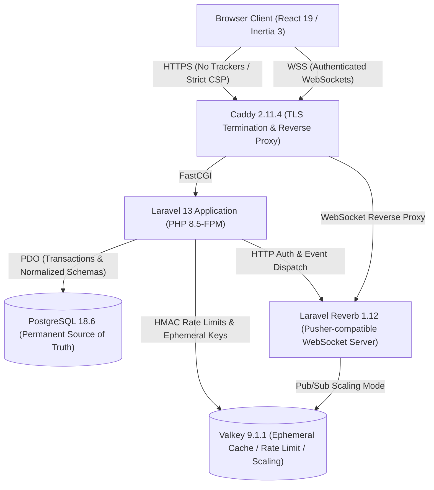
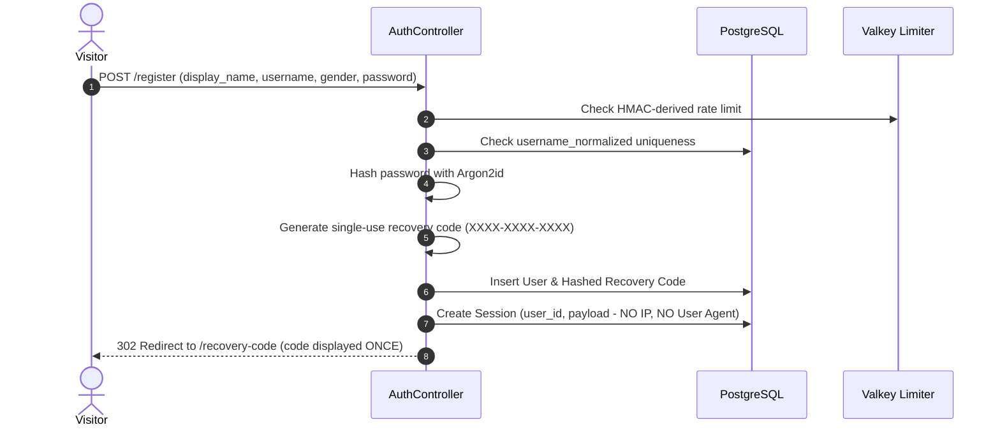
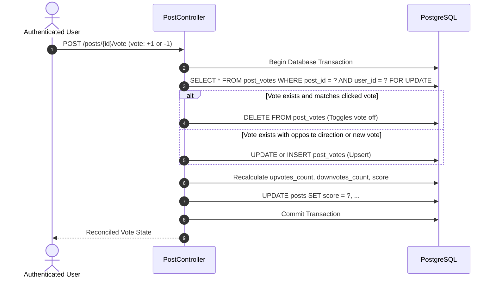
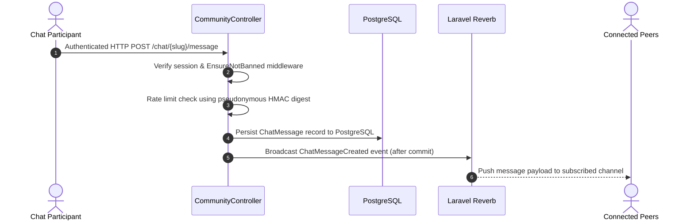

# KYAnonymous Architecture Documentation

KYAnonymous is designed as a **Modular Monolith** using Laravel 13, Inertia 3, React 19, PostgreSQL 18, Valkey 9.1, and Laravel Reverb (§1).

---

## 1. High-Level System Architecture

---

## 2. Authentication Flow (§8, §10, §29)

---

## 3. Atomic Voting Flow (§14)

---

## 4. Realtime Chat Message Architecture (§19, §20)

