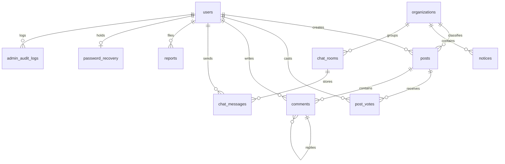

# KYAnonymous Database Architecture

PostgreSQL 18 is the permanent source of truth. Schema design adheres strictly to the minimal data retention policy and privacy-first model.

---

## 1. Entity-Relationship Diagram

---

## 2. Table Specifications & Critical Indexes

### `users`
- `id` (bigint, PK)
- `public_id` (varchar(26), unique ULID)
- `display_name` (varchar(50))
- `username` (varchar(30))
- `username_normalized` (varchar(30), unique index) — NFKC lowercase
- `gender` (enum: Male, Female)
- `show_gender` (boolean, default false)
- `password` (varchar(255), Argon2id)
- `role` (enum: USER, SUPER_ADMIN)
- `status` (enum: ACTIVE, SUSPENDED, BANNED)
- **Constraint:** PostgreSQL partial unique index ensures only one row with `role = 'SUPER_ADMIN'`.

### `sessions` (§29, §37)
- `id` (varchar(255), PK)
- `user_id` (bigint nullable, indexed)
- `payload` (text)
- `last_activity` (integer, indexed)
- **Privacy Rule:** Does NOT contain `ip_address` or `user_agent`.

### `password_recovery` (§10)
- `user_id` (bigint, FK)
- `recovery_code_hash` (varchar(255), Argon2id / Bcrypt)
- `attempts` (integer, default 0)
- `used_at` (timestamp nullable)

### `posts` (§13, §14)
- `public_id` (varchar(26), unique ULID)
- `user_id` (bigint, FK)
- `organization_id` (bigint nullable, FK)
- `title` (varchar(200))
- `body` (text, plaintext safe)
- `upvotes_count` (integer)
- `downvotes_count` (integer)
- `score` (integer, indexed)
- `comments_count` (integer, indexed)
- `comments_locked` (boolean)
- `status` (enum: ACTIVE, REMOVED_BY_AUTHOR, REMOVED_BY_ADMIN)
- `created_at` (timestamp, indexed)

### `post_votes` (§14)
- `post_id` (bigint, FK)
- `user_id` (bigint, FK)
- `vote` (tinyint: +1 or -1)
- **Constraint:** Unique composite `(post_id, user_id)`.

### `comments` (§15)
- `public_id` (varchar(26), unique ULID)
- `post_id` (bigint, FK, indexed)
- `user_id` (bigint, FK)
- `parent_id` (bigint nullable, FK, indexed)
- `depth` (integer, maximum 3)
- `body` (text, plaintext safe)
- `status` (enum: ACTIVE, DELETED, REMOVED_BY_ADMIN)

### `chat_rooms` & `chat_messages` (§19)
- `chat_rooms`: `public_id`, `name`, `slug` (unique), `description`, `is_active`.
- `chat_messages`: `public_id`, `chat_room_id` (FK), `user_id` (FK), `message` (varchar 500). Indexed on `(chat_room_id, created_at)`.

### `admin_audit_logs` (§27)
- `admin_id` (bigint, FK)
- `action` (varchar(50), indexed)
- `target_type` (varchar(30))
- `target_public_id` (varchar(26))
- `safe_metadata` (json)
- `created_at` (timestamp, indexed)
